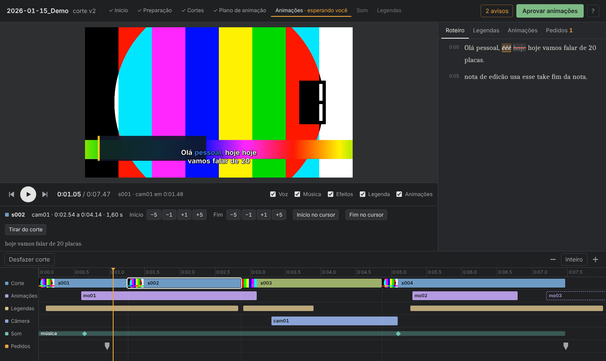
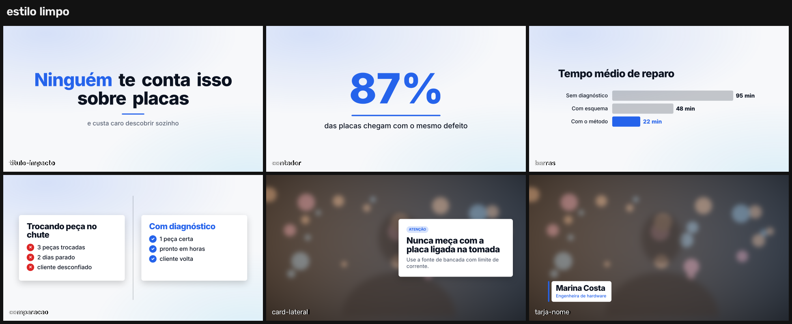

# Fluxo de edição com o Claude Code

Um plugin para o Claude Code que edita vídeo com você, etapa por etapa: cortes, animações, movimentos de câmera e efeitos sonoros, no seu estilo, com entrega no Premiere/DaVinci Resolve ou o vídeo pronto.

Como tudo funciona por dentro (etapas, pastas, efeitos, assets, comandos): [documentação](docs/README.md).

Não é um prompt mágico. É um fluxo de etapas pequenas, cada uma com um trabalho só, que você aprova antes de seguir, com scripts testados fazendo as contas (tempo, frames, XML) e o Claude decidindo sobre o texto. Partiu do fluxo de 8 etapas que o Lucas Leite usa nos vídeos dele ([LeiteZ/fluxo-de-edicao](https://github.com/LeiteZ/fluxo-de-edicao)), com os bons costumes de animação e de fluxo que ele aprendeu testando.

## O que você precisa
- Assinatura do Claude (Pro ou superior) e o [Claude Code](https://claude.com/claude-code).
- Python 3.10+, FFmpeg e Git. O resto (transcrição, HyperFrames…) a montagem confere e instala com você, explicando cada passo.

## Instalar
**Com git** (atualiza com `git pull`, que a própria skill faz para você):
```bash
git clone https://github.com/edsonaa/claude-video-editor ~/.claude/skills/edicao
```
**Ou pelo marketplace de plugins**, dentro do Claude Code:
```
/plugin marketplace add edsonaa/claude-video-editor
/plugin install edicao@edicao-de-video
```
Depois, abra o Claude Code e rode `/edicao:montar`.

## Montar (uma vez, ~10 minutos)
`/edicao:montar` confere o ambiente e pergunta que tipo de vídeo você faz. Você escolhe um ponto de partida e ela pergunta só o que falta:

| Preset | Para quê |
|---|---|
| `youtube-apresentador` | Pessoa falando para a câmera, 16:9, as 8 etapas |
| `tutorial-tela` | Gravação de tela, animação só onde a tela não explica, zoom na tela |
| `aula-tecnica` | Aulas de curso: bancada, tela e muito termo técnico |
| `reels` | Vertical, curto e denso, sem programa: o vídeo sai pronto |
| `narrado` | Só a voz sobre imagens e animações, sem câmera |
| `so-cortes` | O começo mais rápido: só a transcrição e o primeiro corte |

Depois você escolhe um estilo de partida (vendo a vitrine de cada um), ela cria o seu ambiente Python, roda os testes das ferramentas no seu computador e, se você quiser, analisa vídeos de que você gosta para afinar o estilo.

## Editar um vídeo
Abra o Claude Code na pasta do vídeo e digite:
```
/edicao:editar
```
Ela vê em que etapa o vídeo está e te guia, uma etapa por vez. Entre as etapas, `/clear` e `/edicao:editar` de novo: tudo fica salvo no estado do vídeo (`_CLAUDE/projeto.json`).

As etapas também podem ser chamadas direto: `/edicao:iniciar`, `/edicao:preparar`, `/edicao:cortes`, `/edicao:motion-mapa`, `/edicao:assets`, `/edicao:motion-render`, `/edicao:camera`, `/edicao:sfx`, `/edicao:legendas` e `/edicao:render`.

No caminho, o motor também trata a voz (ruído, compressão e loudness no alvo da plataforma, sem tirar de sincronia), monta a música de fundo abaixando sob a fala e faz as legendas: arquivo SRT/VTT ou queimadas, palavra a palavra no estilo de vídeo curto.

### Revisar assistindo
`/edicao:painel` abre o vídeo no navegador já cortado, com as animações, a legenda e o som por cima, sem renderizar nada:
- o **roteiro** mostra a fala com o que saiu do corte riscado: selecione palavras para cortar ou devolver ao vídeo (Ctrl+Z desfaz);
- a **linha do tempo** mostra cada trilha, e cada segmento se ajusta quadro a quadro;
- os **pedidos** ficam presos ao ponto do vídeo e voltam para o Claude como pendências; animações do plano se aprovam ou riscam ali; legendas se corrigem ali;
- dá para **arrastar** como num programa de edição: animações, sons e legendas no tempo, a entrada, a saída e a ordem dos segmentos, e na tela a legenda, a posição e o tamanho das animações e o enquadramento; Ctrl+Z desfaz, e o Claude lê o que mudou;
- o seu **estoque**: mande um trecho de uma legenda, transição, efeito ou motion de que gostou e diga o que gostou; o Claude (`/edicao:estoque`) analisa e constrói, você aprova na prévia, e a peça passa a valer em todos os vídeos;
- a **galeria** (tecla G) mostra legendas, animações, transições e sons com prévia sobre o seu próprio quadro, e põe o escolhido no ponto do cursor (a animação já toca por cima do vídeo antes do render);
- quando estiver bom, **Aprovar** fecha a etapa.

Roda só no seu computador (não sobe nada para a internet). O que o navegador não toca (ProRes, HEVC 10 bits, áudio PCM em MOV, animações com transparência) ganha uma prévia leve com um clique.



### Cortes curtos e publicação
- `/edicao:curtos` lê a fala do vídeo pronto, propõe os trechos que se sustentam sozinhos e cria cada curto como um projeto próprio (os mesmos quadros do longo, recortado em vertical com o rosto no centro, a tela encaixada). Você revisa e ajusta o enquadramento no painel; a legenda queimada e o vídeo vertical saem prontos.
- `/edicao:publicar` escreve com você título, descrição, capítulos, tags e legendas de post, confere tudo contra os limites de cada plataforma (YouTube, Shorts, Instagram, TikTok), sugere capas tiradas do próprio vídeo e monta a pasta `Publicar/` com o que subir em cada uma.

Outros comandos:
- `/edicao:editar aprendizados`: aplica o que você corrigiu nos vídeos ao seu estilo e aos seus ajustes;
- `/edicao:editar atualizar`: traz a versão nova do motor e mostra o que mudou;
- `/edicao:editar config`: mostra e muda as suas escolhas;
- `/edicao:montar`: muda o fluxo, troca de preset, cria um perfil ou uma etapa sua.

## Efeitos e estilos prontos
O motor traz uma **biblioteca de 14 efeitos** de animação (título de impacto, contador, gráfico de barras, comparação, lista de passos, card lateral, print com destaque, cursor, capítulo, transição, tarja de nome, logo, ênfase de frase, legenda animada), todos parametrizados e com prévia animada em [`efeitos/`](efeitos/README.md), e **4 estilos completos** para começar (limpo, tech-neon, editorial, impacto) em [`estilos/`](estilos/README.md). O plano de animação usa os efeitos como repertório, nunca como molde: o conteúdo decide.



## O que é do motor e o que é seu
O plugin é o **motor**: skills, guias e ferramentas. Ele se atualiza, e ninguém precisa editá-lo para personalizar. O que é seu fica em `~/.edicao/`, que nenhuma atualização toca (e que tem histórico git, para desfazer):

| Em `~/.edicao/` | O que é |
|---|---|
| `config.json` | As suas escolhas: programa de revisão, formato, etapas, transcrição, notas faladas, biblioteca de sons |
| `perfis/<nome>/` | O seu gosto: cores, fontes, curvas, quanto zoom, quanto som. Um canal ou cliente novo é um perfil novo |
| `ajustes/<etapa>.md` | O seu jeito de trabalhar: aprendizados que valem para todos os seus vídeos. As skills leem depois das próprias instruções, e o seu ajuste prevalece |
| `etapas/` | Etapas que você criou (ex.: legenda, capítulos) |
| `scripts/` | Scripts escritos para o seu fluxo (ex.: sincronia, render) |

## O que tem aqui
| Pasta | O que tem |
|---|---|
| `docs/` | A documentação: como funciona, pastas e arquivos, efeitos e estilos, assets, comandos |
| `skills/` | A montagem, a `editar` (com as regras comuns), o `painel` de revisão, o `estoque` de peças, `curtos`, `publicar` e uma skill por etapa |
| `guias/` | O ofício: princípios do fluxo, decisões, referências, animação, HyperFrames, entrega no programa de edição e o de cada etapa |
| `ferramentas/` | Os scripts prontos e testados: estado do vídeo, configuração, inventário, silêncios, transcrição, XML (ida e volta), tempo e timecode, legendas, tratamento de áudio, painel de revisão, render, cortes curtos, publicação, folha de contato, índice de sons e rastreio de rosto. Veja o [README](ferramentas/README.md) |
| `efeitos/` | A biblioteca de efeitos HyperFrames, com prévias |
| `estilos/` | Os estilos prontos (perfis completos), com vitrines |
| `presets/` | Os pontos de partida da montagem |
| `modelos/` | O perfil inicial, o formato do perfil e do estado do vídeo |
| `CHANGELOG.md` | As novidades de cada versão do motor |

Tudo em texto. Leia, mude, adapte. Achou algo que vale para todo mundo? Abra uma issue ou um PR.

## Licença
MIT. Fluxo original de Lucas Leite; motor, plugin e ferramentas por Edson.
