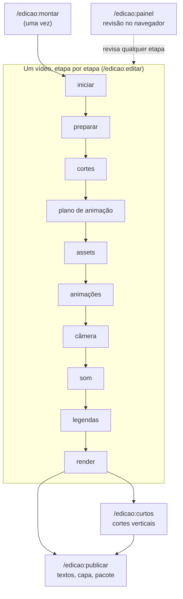

# Documentação

Como o fluxo de edição funciona por dentro: as etapas, onde cada coisa fica, a biblioteca de animações e os materiais que entram no vídeo. Para instalar e começar, veja o [README principal](../README.md).

| Página | O que explica |
|---|---|
| [Como funciona](funcionamento.md) | as três camadas (motor, você, o vídeo), o ciclo de cada etapa, as dez etapas, o estado do vídeo, a revisão, os aprendizados e as atualizações |
| [Pastas e arquivos](pastas.md) | o que tem no motor, em `~/.edicao` e na pasta de cada vídeo (inclusive cada arquivo de `_CLAUDE/`), e quem grava onde |
| [Efeitos e estilos](efeitos.md) | o que é um efeito, os formatos, o catálogo dos 14 efeitos com parâmetros, o caminho do plano até o vídeo, os estilos, o `tema.json` e como criar um efeito novo |
| [Assets](assets.md) | os materiais reais do vídeo: logos, ícones e prints das animações (onde ficam, como são buscados, licenças), a biblioteca de sons, música, fontes e capa |
| [Comandos](comandos.md) | cada script de `ferramentas/` com o uso completo, os módulos para os seus scripts, as variáveis de ambiente e os testes |

## O caminho de um vídeo

Cada preset liga só as etapas que fazem sentido para ele. Quem revisa no Premiere ou no Resolve, por exemplo, não precisa da etapa `render`.

## Mais fundo
- **O ofício de cada etapa** está nos [guias](../guias/): princípios do fluxo, decisões da montagem, análise de referências, animação, HyperFrames, entrega no programa de edição, legendas e áudio, curtos e publicação.
- **As instruções que o Claude segue** estão nas [skills](../skills/), e as regras que valem para todas, em [`skills/editar/regras-comuns.md`](../skills/editar/regras-comuns.md).
- **O formato exato** do estado do vídeo e da configuração está em [`ferramentas/schema/`](../ferramentas/schema/).
- **O que mudou** em cada versão está no [CHANGELOG](../CHANGELOG.md).
