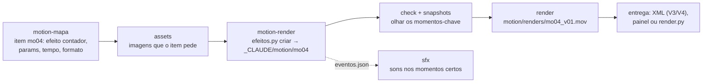

# Efeitos e estilos

O motor traz uma **biblioteca de 14 efeitos** de animação, prontos e parametrizados, e **4 estilos** que definem como eles ficam. As prévias animadas de cada efeito estão na [galeria](../efeitos/README.md); as vitrines dos estilos, em [`estilos/`](../estilos/README.md).

Duas regras guiam o uso:
- **Repertório, nunca molde.** O conteúdo decide a animação. O plano usa um efeito quando ele é a melhor forma *daquela* ideia; no gancho, um conceito próprio do assunto costuma funcionar melhor que qualquer efeito pronto.
- **Ponto de partida, não produto final.** O efeito vira um projeto do vídeo, e o projeto se ajusta à vontade. A biblioteca nunca muda por causa de um vídeo.

## O que é um efeito

Um efeito é uma composição [HyperFrames](../guias/hyperframes.md): uma página HTML com uma linha do tempo GSAP, renderizada quadro a quadro em vídeo. Cada um tem:

```
efeitos/<efeito>/
├── index.html     a composição (usa ../_comum/tema.css e ../_comum/tema.js)
├── efeito.json    formato, duração, parâmetros, eventos de som, quando usar
└── previa.gif     a prévia da galeria (no perfil inicial, neutro)
```

O efeito pega **as cores, as fontes e o movimento do seu perfil** (o `tema.json`) e **o conteúdo do item do plano** (os parâmetros). O mesmo `contador` sai sóbrio no estilo limpo e com batida no impacto.

### Formatos
| Formato | O que é | Arquivo | Trilha no XML |
|---|---|---|---|
| `tela_cheia` | ocupa o quadro inteiro, com fundo e câmera virtual | MP4 | V3 |
| `sobreposicao` | por cima da filmagem, com transparência | MOV com alpha | V4 |
| `sobreposicao_lateral` | por cima, de um lado (o oposto ao rosto) | MOV com alpha | V4 |
| `enfase` | destaque curto de uma frase, por cima | MOV com alpha | V4 |

O `criar` gera o efeito nos quatro tamanhos de vídeo: 16:9 (1920×1080), 9:16 (1080×1920), 1:1 (1080×1080) e 4:5 (1080×1350). No vertical, os efeitos ajustam tamanhos e respeitam a área segura. A biblioteca é conferida em 16:9 e 9:16; num vídeo 1:1 ou 4:5, olhe os snapshots antes de renderizar.

## Catálogo

Parâmetros em **negrito** são obrigatórios. Os eventos de som são os momentos que o efeito anota para a etapa de som (`eventos.json`).

| Efeito | Nome | Formato | Duração (mín–máx) | Parâmetros | Eventos de som |
|---|---|---|---|---|---|
| `barras` | Gráfico de barras | tela cheia | 5 s (3–10) | `titulo`, **`dados`**, `unidade`, `destaque`, `casas` | titulo_entra, barra_cresce |
| `capitulo` | Marcador de capítulo | sobreposição | 3,5 s (2–6) | **`numero`**, `total`, **`titulo`** | pilula_entra, progresso |
| `card-lateral` | Card lateral | lateral | 5 s (2,5–10) | `etiqueta`, **`titulo`**, `texto`, `imagem`, `lado` | card_entra, card_sai |
| `comparacao` | Comparação lado a lado | tela cheia | 6 s (3,5–12) | `titulo_a`, `titulo_b`, `itens_a`, `itens_b`, `marcas` | divisor, colunas_entram, item |
| `contador` | Contador | tela cheia | 3,5 s (2–7) | **`valor`**, `inicio`, `casas`, `prefixo`, `sufixo`, `rotulo` | contagem, trava |
| `cursor-clique` | Cursor e clique | sobreposição | 2,5 s (1,5–5) | `de`, **`ate`**, `rotulo` | movimento_cursor, clique |
| `enfase-frase` | Ênfase de frase | ênfase | 3 s (1,5–6) | **`frase`**, `destaque`, `posicao` | texto_entra, marca_texto |
| `legenda-animada` | Legenda animada | sobreposição | 6 s (1–300) | **`blocos`**, `modo`, `posicao` | — |
| `lista-passos` | Lista de passos | tela cheia | 6 s (3–14) | `titulo`, **`itens`**, `intervalo_f` | titulo_entra, passo_entra |
| `logo-revela` | Revelação de logo | tela cheia | 3,5 s (2–6) | `imagem`, `nome`, `apoio` | revela, letras |
| `print-destaque` | Print com destaque | tela cheia | 5 s (3–10) | `imagem`, `url`, `regiao`, `rotulo`, `zoom` | janela_entra, zoom, caixa_desenha |
| `tarja-nome` | Tarja de nome | sobreposição | 4 s (2,5–8) | **`nome`**, `cargo`, `lado` | abre_caixa, sai |
| `titulo-impacto` | Título de impacto | tela cheia | 3,5 s (2–7) | **`texto`**, `destaque`, `apoio` | entrada_palavras, sai_desfocando |
| `transicao-rampa` | Transição com rampa | sobreposição | 1 s (0,6–1,6) | `direcao` | whoosh_rampa |

Para ver a descrição, os valores padrão e "bom para / evitar" de um efeito: `efeitos.py mostrar <efeito>`. A `legenda-animada` é especial: os blocos vêm prontos do `legendas.py exportar --formatos hyperframes`.

### Tipos de parâmetro
| Tipo | Exemplo | Observação |
|---|---|---|
| `texto` | `--param rotulo="das placas chegam com o mesmo defeito"` | |
| `numero` | `--param valor=87` | |
| `opcao` | `--param lado=direita` | só os valores de `opcoes` |
| `lista` | `--param itens='["Medir","Trocar","Testar"]'` | JSON; listas de objetos também (`dados` do `barras`) |
| `imagem` | `--param imagem=Assets/notion.svg` | o arquivo é copiado para `assets/` do projeto; sem ele, aparece o marcador **ASSET FALTANDO** |
| `cor`, `booleano` | `"#FACC15"`, `true` | aceitos pelo formato; nenhum efeito atual usa |

Além dos parâmetros do efeito, um item pode ajustar o tema só para si, com as mesmas variáveis do tema: `--param velocidade=0.8` deixa só aquela animação mais lenta.

## Do plano ao vídeo



1. **No plano** (`/edicao:motion-mapa`), um item que usa um efeito ganha `"efeito": "contador"` e `"params": {…}`, além de tempo, formato e ideia. Você também escolhe direto na **galeria do painel**: o efeito toca no navegador com o tema do seu perfil, você preenche o conteúdo vendo a prévia e insere no ponto do cursor (o item entra `aprovado`, com `origem: painel`, e já toca por cima do vídeo no painel antes do render).
2. **No render** (`/edicao:motion-render`), o efeito vira um projeto do vídeo:
   ```bash
   efeitos.py criar contador _CLAUDE/motion/mo04 --perfil ~/.edicao/perfis/padrao \
       --param valor=87 --param sufixo=% --param rotulo="das placas chegam com o mesmo defeito" \
       --duracao 3.5 --fps 30000/1001 --formato 16:9
   ```
   O `criar` grava a duração exata em quadros (pela taxa do vídeo), o tamanho do formato, o tema do perfil e o conteúdo nas variáveis da composição, e os eventos de som em `eventos.json`. Daí em diante é um projeto HyperFrames comum: `check`, `snapshot`, `render`.
3. **Conferido e registrado**, o render entra no plano (`status: renderizado`) e na entrega: no XML (V3 ou V4), no painel (por cima do vídeo, com transparência) e no `render.py`.
4. **No som**, os eventos do efeito (somados ao início do item) dizem onde cada som entra.

## Estilos

Um estilo é um **perfil completo pronto**: identidade, `tema.json`, estilo de animação, câmera, cortes e som, e o catálogo de efeitos que combinam. Você escolhe um na montagem; o perfil copiado é seu e muda com o caderno de aprendizados.

| Estilo | Cara | Fundo / texto / destaque | Fontes (OFL) | Movimento |
|---|---|---|---|---|
| `limpo` | claro, sóbrio, direto | `#F7F8FA` / `#0B1220` / `#2563EB` | Inter / Inter | entrada 15 f, sem passar do ponto |
| `tech-neon` | escuro, ciano e roxo, borda luminosa | `#070B1A` / `#E6F1FF` / `#22D3EE` | Montserrat / Inter | 13 f, passa um pouco do ponto, ×1,1 |
| `editorial` | papel creme, serifa, sombras suaves | `#F4EFE6` / `#2B2118` / `#B4400B` | Lora / DM Sans | 20 f, assentado, ×0,85 |
| `impacto` | preto e amarelo, condensado, com batida | `#0A0A0A` / `#FFFFFF` / `#FACC15` | Anton / Inter | 10 f, passa do ponto e assenta, ×1,35 |

```bash
config.py estilos                                  # os estilos e o que cada um é
config.py perfil-novo meu-canal --estilo tech-neon # um perfil novo a partir de um estilo
efeitos.py vitrine vitrine.png --estilo impacto    # seis efeitos no mesmo estilo, numa imagem
efeitos.py previa contador contador.gif --perfil ~/.edicao/perfis/meu-canal
```

As fontes do estilo precisam estar instaladas no computador que renderiza; sem elas, o navegador usa uma substituta e o desenho muda.

### O `tema.json`
É o que os efeitos leem do perfil. Os campos:

| Campo | O que controla |
|---|---|
| `cores` | `fundo`, `superficie`, `texto`, `texto_suave`, `destaque`, `apoio` |
| `fontes`, `pesos` | `titulo`, `texto`, `numeros`; o peso do título e do texto |
| `tracking_titulo`, `caixa_titulo` | espaçamento do título (em em) e caixa alta (`alta`) ou normal |
| `raio` | o arredondamento de cards e caixas, em px |
| `material` | `plano`, `vidro`, `neon` ou `papel`: como as superfícies parecem |
| `movimento` | `entrada_f` e `saida_f` (em quadros de 1/30 s), `ease_entrada`, `ease_saida`, `overshoot` (0 = sem passar do ponto), `velocidade` (>1 mais rápido) |

Mudar um número no `tema.json` muda todos os efeitos daquele perfil de uma vez.

## Criar um efeito novo

Um efeito que ficou bom num vídeo, ou um que você viu em outro vídeo, entra no **seu estoque** (`/edicao:estoque`, ou no painel: Galeria → Estoque): o Claude constrói a peça no mesmo formato abaixo, em `~/.edicao/estoque/efeitos/` ou `motions/`, e ela passa a valer como as do motor. Se serve a qualquer pessoa, pode entrar na biblioteca do motor (issue ou PR). Para entrar na biblioteca:

1. **`efeitos/<nome>/index.html`**
   - um `#root` com `data-duration`, `data-width`, `data-height` e `data-fps` (o `criar` reescreve os quatro), e `data-composition-variables` no `<html>`;
   - `../_comum/tema.css` e `../_comum/tema.js`: as variáveis CSS `--t-*` (cores, fontes, raio) e as funções `HF.*` (tempos na curva e na velocidade do estilo, `HF.entrada`, `HF.saida`, `HF.palavras`, `HF.contar`, `HF.imagem`, `HF.camera`);
   - a linha do tempo pausada registrada com `HF.pronto(tl)`;
   - as armadilhas do [guia do HyperFrames](../guias/hyperframes.md): partida explícita em todo `fromTo`, `xPercent` em vez de `transform` no CSS, nada de `Math.random` ou `Date.now`, e "f" sempre igual a 1/30 s.
2. **`efeitos/<nome>/efeito.json`** com `titulo`, `descricao`, `formato`, `duracao` (`padrao`, `min`, `max`), `parametros` (`id`, `tipo`, `rotulo`, `padrao`, `obrigatorio`, `opcoes`, `descricao`), `exemplo` (os parâmetros da prévia), `eventos_som` (`t` em quadros, negativo conta do fim; `tipo`, `forca`, `descricao`), `bom_para`, `evitar` e `tags`.
3. **A prévia:** `efeitos.py previa <nome> efeitos/<nome>/previa.gif`.
4. **Testar:**
   - os testes conferem a estrutura de todo efeito;
   - rode o `check` do HyperFrames em pelo menos dois estilos (um claro e um escuro) e nos formatos 16:9 e 9:16: `HYPERFRAMES_CMD=… pytest ferramentas/testes/test_efeitos.py`;
   - abra os snapshots e olhe.
5. Acrescente o efeito à [galeria](../efeitos/README.md) e ao catálogo desta página.
