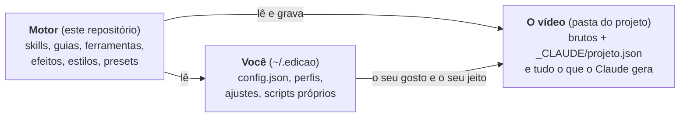
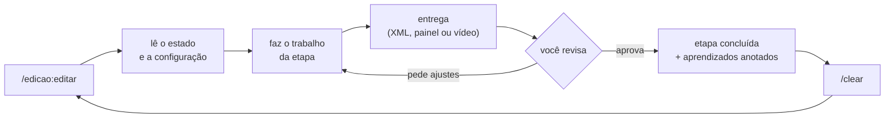

# Como funciona

O plugin edita vídeo com você em **etapas pequenas**, cada uma com um trabalho só. O Claude decide sobre o texto (o que cortar, onde animar, que som pôr), os **scripts testados** fazem as contas (tempo, quadros, XML, áudio) e **você aprova** cada etapa antes de seguir. Tudo o que foi feito fica gravado no **estado do vídeo**, então dá para parar, limpar a conversa e continuar depois.

## As três camadas

| Camada | Onde fica | Quem muda | O que guarda |
|---|---|---|---|
| **Motor** | a pasta do plugin (`${CLAUDE_PLUGIN_ROOT}`) | as atualizações (`/edicao:editar atualizar`) | como fazer: skills, guias de ofício, scripts, a biblioteca de efeitos e de estilos |
| **Você** | `~/.edicao/` (ou `EDICAO_HOME`) | você e o caderno de aprendizados; nenhuma atualização mexe | o seu fluxo (etapas, programa, formato), o seu gosto (perfis) e o seu jeito de trabalhar (ajustes) |
| **O vídeo** | a pasta do projeto, onde você abre o Claude Code | as etapas, sempre em `_CLAUDE/` | o estado (`projeto.json`) e cada arquivo gerado, com versão |

Quem manda quando duas regras se cruzam, do mais geral ao mais específico: **guia do motor → `ajustes/geral.md` → `ajustes/<etapa>.md` → perfil → briefing e notas faladas do vídeo → o que você pediu agora**. O seu ajuste sempre vence o guia do motor.

## O ciclo de cada etapa

1. **`/edicao:editar`** lê o estado e diz em que etapa o vídeo está. Ela nunca pula uma etapa nem encadeia duas sozinha.
2. A skill da etapa lê o que precisa: o estado (por resumos, nunca o arquivo inteiro), a configuração, o perfil e os seus ajustes.
3. Ela trabalha e **entrega** do jeito que você revisa (veja "Revisão" abaixo). Cada entrega é uma **versão nova** (`_v02`); nada que já foi entregue é sobrescrito.
4. Você pede ajustes citando o número do item (`mo04 mais lento`), o tempo do vídeo (`em 1:12 tira essa frase`) ou deixando pedidos no painel.
5. Toda correção que vale **para outros vídeos** vai para o caderno `_CLAUDE/aprendizados.md`. Anotar não muda nada: o caderno só vira regra quando você pede `/edicao:editar aprendizados`.
6. Aprovada, a etapa fica `concluido`. Entre etapas, `/clear` e `/edicao:editar` de novo: tudo continua de onde parou, e a conversa recomeça leve.

## As etapas

O fluxo completo tem dez etapas. Cada preset liga as que fazem sentido (o `reels`, por exemplo, não usa programa de edição e termina no `render`). Ligar ou desligar: `/edicao:montar` ou `config.py set fluxo '[...]'`.

| Etapa | Skill | O que faz | Grava | Scripts principais |
|---|---|---|---|---|
| 1. Iniciar | `/edicao:iniciar` | abre o projeto, cria o estado e organiza o briefing que você dita | `projeto.json`, `briefing.md` | `estado.py --init` |
| 2. Preparar | `/edicao:preparar` | inventário, sincronia, transcrição, silêncios, notas faladas e o tratamento da voz | `midia`, `transcricao`, `notas_edicao`, voz tratada | `midia.py`, `transcrever.py`, `silencios.py`, `audio.py` |
| 3. Cortes | `/edicao:cortes` | escolhe os takes, tira erros e pausas, entrega o primeiro corte | `cortes`, `marcadores` | `exportar_xml.py`, `painel.py` |
| 4. Plano de animação | `/edicao:motion-mapa` | decide onde entra animação, o que mostra e em que formato, sem animar | `motions` (itens `proposto`) | `transcrever.py fala`, `efeitos.py listar` |
| 5. Assets | `/edicao:assets` | busca logos, ícones e prints que as animações precisam | os arquivos em `Assets/`, `creditos.md` | (script de busca do seu fluxo) |
| 6. Animações | `/edicao:motion-render` | constrói e renderiza cada animação aprovada | `_CLAUDE/motion/`, `motions[].render` | `efeitos.py criar`, HyperFrames |
| 7. Câmera | `/edicao:camera` | zooms e movimentos casados com a fala e as animações | `camera` | `rosto.py`, `contato.py` |
| 8. Som | `/edicao:sfx` | efeitos sonoros em camadas e a música com ducking | `sfx` | `sons.py`, `audio.py musica` |
| 9. Legendas | `/edicao:legendas` | legendas pela transcrição e pelos cortes: arquivo ou queimadas | `legendas` | `legendas.py` |
| 10. Render | `/edicao:render` | monta e exporta o vídeo pronto (quem não revisa num programa) | `Renders/…_final_vNN.mp4`, `entregas` | `render.py` |

Depois do vídeo pronto, duas skills que não são etapas:
- **`/edicao:curtos`**: tira cortes curtos verticais do vídeo longo. Cada curto vira um projeto próprio em `Curtos/<nome>/`, com fluxo cortes → legendas → render.
- **`/edicao:publicar`**: títulos, descrição, capítulos, tags, capa e a pasta `Publicar/` pronta para subir.

E uma que serve a qualquer etapa: **`/edicao:painel`**, a revisão no navegador.

## O estado do vídeo

`_CLAUDE/projeto.json` é a memória do fluxo. O formato completo está em [`ferramentas/schema/projeto.schema.json`](../ferramentas/schema/projeto.schema.json); quem lê e grava é o `estado.py` (e os outros scripts, pelos mesmos módulos). Ninguém abre esse arquivo à mão: num vídeo longo ele tem dezenas de milhares de tokens.

Os blocos, na ordem em que as etapas os preenchem:

| Bloco | O que guarda |
|---|---|
| `fluxo`, `etapas` | as etapas deste vídeo e o status de cada uma (`pendente`, `em_andamento`, `aguardando_aprovacao`, `concluido`, `nao_precisa`) |
| `midia` | fps exato, resolução e cada arquivo (`cam01`, `tela01`…) com tipo, duração, proxy e voz tratada |
| `transcricao`, `notas_edicao` | as palavras de cada arquivo e as notas faladas ("nota de edição … fim da nota") |
| `cortes` | os segmentos (`s001`…) no tempo do arquivo de origem, com versão |
| `marcadores` | dúvidas de take, sugestões e alertas do Claude |
| `motions` | o plano de animação (`mo01`…), com status, formato, efeito, assets e o render |
| `camera`, `sfx` | movimentos de câmera; efeitos sonoros (`sfx01`…) e a música |
| `legendas` | a versão atual dos blocos (`l001`…) e as saídas exportadas |
| `video` | o que é só deste vídeo (formato de um curto, de onde ele veio) |
| `curtos`, `publicacao` | os curtos tirados deste vídeo; os textos, capítulos, capa e o pacote |
| `pendencias`, `entregas` | os pedidos ainda não aplicados (`p01`…) e cada arquivo entregue |

Quatro ideias seguram tudo:
- **Dois relógios.** Cortes, marcadores, notas e pedidos ficam no **tempo do arquivo de origem**, que não muda quando o corte muda. Animações, som e legendas ficam no **tempo da sequência** (`inicio_seq`). A conversão entre os dois é sempre a mesma (`edicao.linha`), com a taxa exata (29,97 é 30000/1001) e quadros inteiros (`edicao.tempo`).
- **Versões que avisam.** `cortes.versao` e `motions.versao` sobem sozinhas quando o conteúdo muda. Cada etapa guarda sobre qual versão foi feita, e o status avisa: "o corte mudou depois do plano de animação". Mudar só o status de uma animação, o texto ou o enquadramento de um segmento não conta como mudança.
- **Ids estáveis.** `s003`, `mo04`, `sfx12`, `l014`, `p02`: é por eles que você pede ajustes, e eles não mudam de uma versão para outra.
- **Gravação segura.** Toda gravação é validada (estado inválido não é gravado) e atômica. A `revisao` sobe a cada gravação: se o painel e o Claude gravarem ao mesmo tempo, o segundo recebe um conflito em vez de apagar o trabalho do primeiro.

## Revisão

Como as entregas chegam até você depende de `revisao.programa` na configuração:

| Programa | Como você revisa |
|---|---|
| `premiere` / `resolve` | um **FCP 7 XML** por entrega (`_CLAUDE/entregas/`): V1 câmera, V3 animações em tela cheia, V4 sobreposições, V5 legenda animada; A1 voz, A2 música, efeitos abaixo. A primeira entrega de todas é um arquivo de teste. Ajustou no programa? A **volta** (`exportar_xml.py volta`) lê o que você exportou, e os seus ajustes valem mais. |
| `nenhum` | o **painel** e o **rascunho** (`render.py rascunho`); o final sai na etapa `render`. |
| qualquer um | o **painel** (`/edicao:painel`): o vídeo já cortado no navegador, com animações, legenda e som, sem renderizar. O roteiro mostra o que saiu do corte e deixa cortar ou devolver frases, os pedidos ficam presos ao ponto do vídeo e a etapa se aprova ali. |

## Aprendizados

O fluxo melhora vídeo a vídeo pelo caderno `_CLAUDE/aprendizados.md`. Durante a revisão, o Claude anota cada pedido que vale para outros vídeos ("zoom mais sutil"), mas não o que é só deste ("tira essa frase"). Quando você pede `/edicao:editar aprendizados`, cada linha ganha um destino que você aprova:
- **gosto** (cores, quanto zoom, quanto som) vai para o perfil (`perfis/<nome>/`);
- **jeito de trabalhar** vai para `ajustes/<etapa>.md` ou `ajustes/geral.md`;
- **algo que vale para todo mundo** (um erro do motor) vai para os ajustes, e o Claude sugere propor a correção ao motor.

A pasta `~/.edicao` tem histórico git: toda mudança de perfil e de ajuste pode ser desfeita.

## Atualizações

`/edicao:editar atualizar` traz a versão nova do motor (`git pull`) e mostra o que mudou desde a última vez (`config.py novidades`, a partir do [`CHANGELOG.md`](../CHANGELOG.md)). O que é seu (`~/.edicao`) e o que é do vídeo (`_CLAUDE/`) nunca são tocados.

## Comandos do dia a dia

| Comando | Para quê |
|---|---|
| `/edicao:montar` | a primeira vez, ou mudar o fluxo, o preset, criar um perfil ou uma etapa sua |
| `/edicao:editar` | continuar o vídeo de onde parou (o comando de todo dia) |
| `/edicao:editar aprendizados` | aplicar o caderno ao seu perfil e aos seus ajustes |
| `/edicao:editar config` | ver e mudar as suas escolhas |
| `/edicao:editar atualizar` | trazer a versão nova do motor |
| `/edicao:painel` | revisar assistindo, no navegador |
| `/edicao:curtos` | cortes curtos do vídeo pronto |
| `/edicao:publicar` | preparar a publicação |
| `/edicao:<etapa>` | chamar uma etapa direto (`/edicao:cortes`, `/edicao:sfx`…) |

Os scripts que as skills usam estão em [comandos.md](comandos.md).
