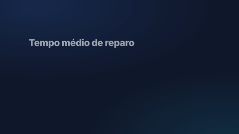
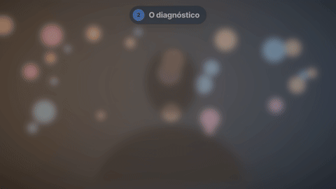
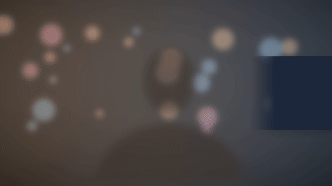
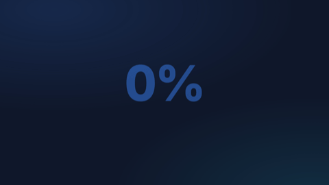
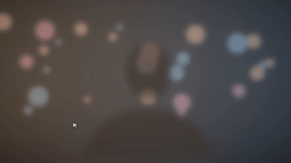
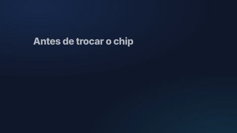
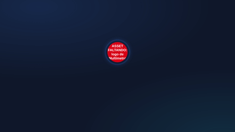
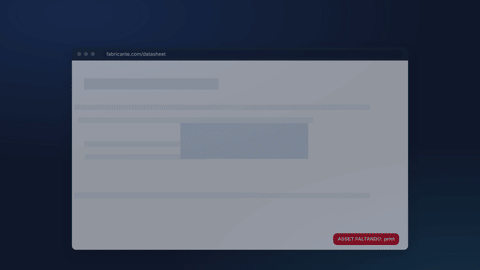

# Biblioteca de efeitos

Composições HyperFrames prontas, parametrizadas e testadas (`check` de todas em todos os estilos, HyperFrames 0.9.70). Cada uma pega as cores, fontes e curvas do perfil da pessoa e o conteúdo do item do plano.

```bash
python ferramentas/efeitos.py listar                       # o que existe
python ferramentas/efeitos.py mostrar contador             # parâmetros, duração, eventos de som, quando usar
python ferramentas/efeitos.py criar contador _CLAUDE/motion/mo04 \
    --perfil ~/.edicao/perfis/padrao --param valor=87 --param sufixo=% \
    --param rotulo="das placas chegam com o mesmo defeito" --duracao 3.5 --fps 30000/1001
cd _CLAUDE/motion/mo04 && npx --yes hyperframes@0.9.70 check . && npx --yes hyperframes@0.9.70 render . --fps 30000/1001
```

O `criar` grava a duração exata em frames, o tamanho do formato (16:9, 9:16, 1:1, 4:5) e os eventos para o som (`eventos.json`). Depois, o projeto é seu: ajuste à vontade, a biblioteca não muda. **Repertório, nunca obrigação**: o conteúdo decide a animação (`guias/etapa-motion-mapa.md`).

As prévias usam o perfil inicial (neutro). Para ver um estilo: `efeitos.py previa <efeito> saida.gif --estilo impacto`, ou as vitrines em [`estilos/`](../estilos/README.md).

## Gráfico de barras · `barras`



Barras horizontais que crescem em sequência com o valor contando na ponta, e uma delas em destaque. Para comparar poucas coisas (2 a 6).

- **Formato:** tela cheia (MP4) · **duração:** 5 s (3–10 s)
- **Parâmetros:** `titulo`, `dados`, `unidade`, `destaque`, `casas`
- **Bom para:** comparar poucas opções; antes e depois em números
- **Evitar:** mais de 6 barras; dados que precisam de eixo e escala exatos

## Marcador de capítulo · `capitulo`



Uma pílula no alto com o número e o nome da parte, e uma barra de progresso do vídeo que enche até aquela parte. Discreta, sobre a filmagem.

- **Formato:** sobreposição (MOV com alpha) · **duração:** 3.5 s (2–6 s)
- **Parâmetros:** `numero`, `total`, `titulo`
- **Bom para:** abrir cada parte de um vídeo longo ou aula; situar quem pulou para o meio
- **Evitar:** vídeos curtos; partes sem nome claro

## Card lateral · `card-lateral`



Um card grande num lado do quadro, com etiqueta, título, texto curto e imagem opcional, enquanto o rosto fica no terço oposto. Entra deslizando do lado de fora e sai pelo mesmo lado.

- **Formato:** sobreposição lateral (MOV) · **duração:** 5 s (2.5–10 s)
- **Parâmetros:** `etiqueta`, `titulo`, `texto`, `imagem`, `lado`
- **Bom para:** dica, aviso ou definição enquanto a pessoa fala; ferramenta citada com imagem
- **Evitar:** texto longo (o card não é slide); sem a câmera levar o rosto para o terço

## Comparação lado a lado · `comparacao`


Duas colunas (antes e depois, errado e certo, A e B) que entram dos lados, com um divisor no meio e os itens marcados com ✕ e ✓. Na vertical, uma coluna em cima da outra.

- **Formato:** tela cheia (MP4) · **duração:** 6 s (3.5–12 s)
- **Parâmetros:** `titulo_a`, `titulo_b`, `itens_a`, `itens_b`, `marcas`
- **Bom para:** antes e depois; o jeito errado e o certo; duas opções
- **Evitar:** listas desiguais demais; mais de 4 itens por lado

## Contador · `contador`



Um número grande contando até o valor, com prefixo e sufixo, um rótulo embaixo e uma barra fina que enche junto. Assenta com um leve pulso no fim.

- **Formato:** tela cheia (MP4) · **duração:** 3.5 s (2–7 s)
- **Parâmetros:** `valor`, `inicio`, `casas`, `prefixo`, `sufixo`, `rotulo`
- **Bom para:** estatísticas, preços, resultados; um número que sustenta o argumento
- **Evitar:** números que a pessoa não diz na fala (o som e a imagem brigam)

## Cursor e clique · `cursor-clique`



Um cursor que viaja de um ponto a outro numa curva natural, clica com uma onda e mostra um balão com o rótulo. Para apontar onde clicar sobre uma gravação de tela.

- **Formato:** sobreposição (MOV com alpha) · **duração:** 2.5 s (1.5–5 s)
- **Parâmetros:** `de`, `ate`, `rotulo`
- **Bom para:** tutoriais com tela: onde clicar, qual menu, qual botão
- **Evitar:** seguir o cursor real da gravação (já aparece); vários cliques seguidos numa tela só

## Ênfase de frase · `enfase-frase`


A frase que está sendo dita aparece grande sobre a filmagem, com um marca-texto crescendo atrás da palavra-chave. Um degradê escurece só a parte de baixo, para ler sobre qualquer imagem.

- **Formato:** ênfase sobre a filmagem (MOV) · **duração:** 3 s (1.5–6 s)
- **Parâmetros:** `frase`, `destaque`, `posicao`
- **Bom para:** a frase-chave dita pelo apresentador; números e nomes que precisam ficar na cabeça
- **Evitar:** repetir a mesma ênfase várias vezes no corpo (perde força)

## Lista de passos · `lista-passos`



Um título e passos numerados que entram um a um no ritmo da fala; o passo atual fica aceso e os anteriores esmaecem um pouco.

- **Formato:** tela cheia (MP4) · **duração:** 6 s (3–14 s)
- **Parâmetros:** `titulo`, `itens`, `intervalo_f`
- **Bom para:** processos, checklists, ordem de operações
- **Evitar:** passos longos (mais de ~6 palavras); mais de 6 passos numa tela só

## Revelação de logo · `logo-revela`



Um logo (ou imagem) revelado por um círculo que se abre, com um anel de luz, e o nome entrando letra por letra embaixo. Sem a imagem, mostra o marcador de ASSET FALTANDO no lugar.

- **Formato:** tela cheia (MP4) · **duração:** 3.5 s (2–6 s)
- **Parâmetros:** `imagem`, `nome`, `apoio`
- **Bom para:** apresentar uma ferramenta, marca ou produto citado
- **Evitar:** logo redesenhado ou 'parecido' (use o oficial; sem ele, fica o marcador)

## Print com destaque · `print-destaque`



Um print de site ou programa dentro de uma janela, que entra e depois aproxima até uma região, desenhando uma caixa de destaque ao redor e escurecendo o resto, com um rótulo.

- **Formato:** tela cheia (MP4) · **duração:** 5 s (3–10 s)
- **Parâmetros:** `imagem`, `url`, `regiao`, `rotulo`, `zoom`
- **Bom para:** mostrar onde clicar ou o que ler num site, datasheet, programa
- **Evitar:** print com dado pessoal ou tela logada de terceiros; zoom num texto que fica ilegível

## Tarja de nome · `tarja-nome`


Nome e cargo (ou um dado curto) numa caixa que se abre a partir de uma barra de destaque, no canto de baixo. A apresentação clássica de quem fala, ou de um nome citado.

- **Formato:** sobreposição (MOV com alpha) · **duração:** 4 s (2.5–8 s)
- **Parâmetros:** `nome`, `cargo`, `lado`
- **Bom para:** apresentar quem fala na primeira aparição; nomear um especialista citado
- **Evitar:** mais de uma por minuto; sobre gravação de tela (tampa a interface)

## Título de impacto · `titulo-impacto`


Uma frase curta em tela cheia, palavra por palavra, com uma palavra em destaque e uma linha de apoio opcional. A câmera virtual se aproxima devagar o tempo todo.

- **Formato:** tela cheia (MP4) · **duração:** 3.5 s (2–7 s)
- **Parâmetros:** `texto`, `destaque`, `apoio`
- **Bom para:** gancho; a frase-chave do vídeo; abrir um capítulo
- **Evitar:** frases longas (vira leitura); usar várias vezes seguidas

## Transição com rampa · `transicao-rampa`


Painéis de cor atravessam o quadro em diagonal, acelerando até cobrir tudo e freando ao sair (speed ramp). Fica por cima do corte entre duas cenas, com transparência nas pontas.

- **Formato:** sobreposição (MOV com alpha) · **duração:** 1.0 s (0.6–1.6 s)
- **Parâmetros:** `direcao`
- **Bom para:** troca de assunto, de cenário ou de capítulo; disfarçar um corte grande
- **Evitar:** entre frases do mesmo raciocínio (vira enfeite)

## Criar um efeito novo

Uma pasta `efeitos/<nome>/` com `index.html` (use `../_comum/tema.css` e `../_comum/tema.js`, as variáveis CSS `--t-*` e as funções `HF.*`; siga as armadilhas de `guias/hyperframes.md`) e `efeito.json` (formato, duração, parâmetros, `exemplo`, eventos de som). Os testes conferem a estrutura; rode o `check` do HyperFrames em pelo menos dois estilos (um claro, um escuro) e nos dois formatos antes de propor.
