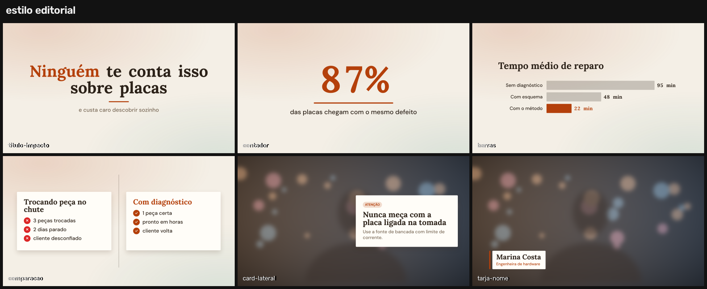
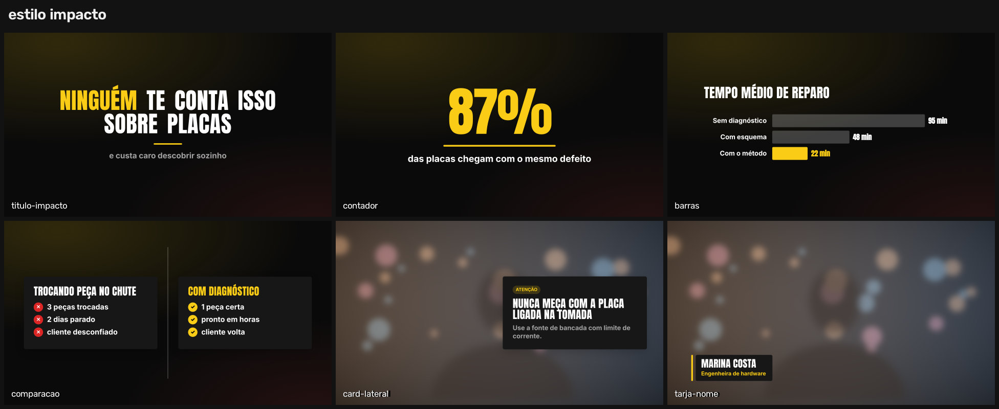
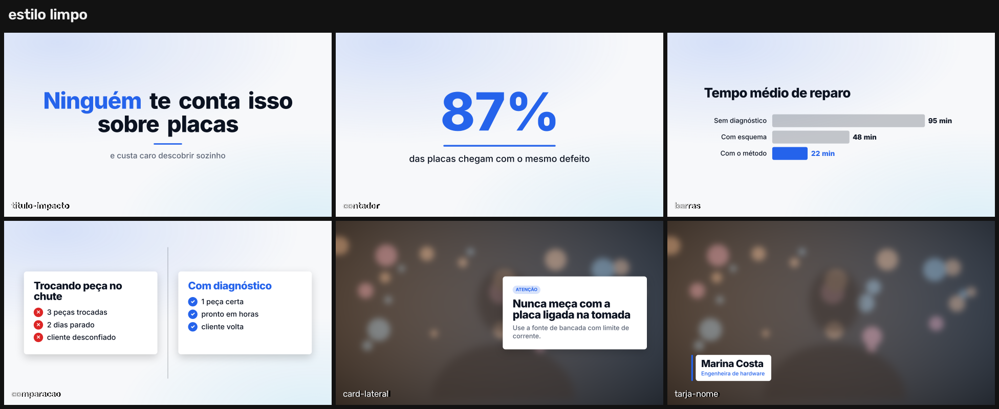
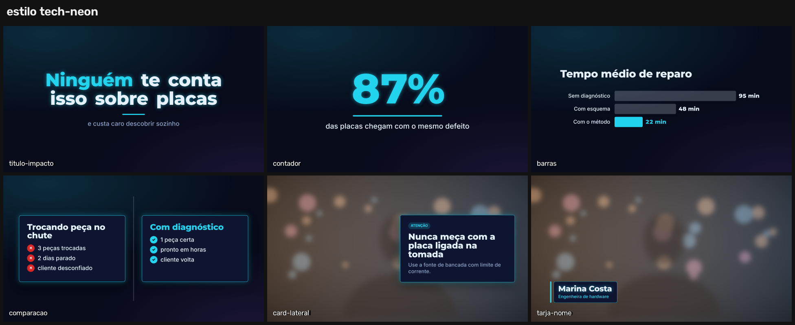

# Estilos

Perfis completos para começar: identidade (cores, fontes, material), estilo de motion, câmera, cortes e som, catálogo de efeitos que combinam e o `tema.json` que os efeitos leem. Escolha um na montagem (`/edicao:montar`) ou crie um perfil a partir dele:

```bash
python ferramentas/config.py estilos
python ferramentas/config.py perfil-novo meu-canal --estilo tech-neon
```

O perfil copiado é seu: mude à vontade, com referências e com o caderno de aprendizados. As vitrines mostram os mesmos seis efeitos em cada estilo.

## Editorial · `editorial`



Papel creme, títulos em serifa, terracota e verde-petróleo de apoio, sombras suaves. Movimento mais lento e assentado, como revista.

- **Bom para:** vídeo-ensaio, narrado, história, cultura, explicativos calmos
- **Cores:** fundo `#F4EFE6`, texto `#2B2118`, destaque `#B4400B`, apoio `#0F766E`
- **Fontes:** Lora / DM Sans (OFL) · **material:** papel · **movimento:** entrada 20 f, `power3.out`, velocidade ×0.85

## Impacto · `impacto`



Preto e amarelo, títulos condensados em caixa alta, tudo rápido e com batida: chega passando do ponto e assenta. Feito para reter em vídeo curto.

- **Bom para:** reels, shorts, TikTok; ganchos agressivos; conteúdo de retenção
- **Cores:** fundo `#0A0A0A`, texto `#FFFFFF`, destaque `#FACC15`, apoio `#EF4444`
- **Fontes:** Anton / Inter (OFL) · **material:** plano · **movimento:** entrada 10 f, `expo.out`, overshoot 1.7, velocidade ×1.35

## Limpo · `limpo`



Claro, sóbrio e direto: fundo quase branco, texto escuro, um azul de destaque. Movimento firme, sem passar do ponto.

- **Bom para:** tutoriais, aulas, conteúdo técnico e corporativo; quem quer clareza acima de tudo
- **Cores:** fundo `#F7F8FA`, texto `#0B1220`, destaque `#2563EB`, apoio `#0EA5E9`
- **Fontes:** Inter / Inter (OFL) · **material:** plano · **movimento:** entrada 15 f, `expo.out`, velocidade ×1

## Tech neon · `tech-neon`



Escuro com ciano e roxo, superfícies com borda luminosa e um leve brilho no texto. Rápido, com um pequeno passo além na chegada.

- **Bom para:** tecnologia, games, hardware, programação; canal com cara de 'futuro'
- **Cores:** fundo `#070B1A`, texto `#E6F1FF`, destaque `#22D3EE`, apoio `#A855F7`
- **Fontes:** Montserrat / Inter (OFL) · **material:** neon · **movimento:** entrada 13 f, `expo.out`, overshoot 1.2, velocidade ×1.1

As fontes precisam estar instaladas no computador que renderiza; sem elas, o navegador usa uma substituta e o desenho muda.
