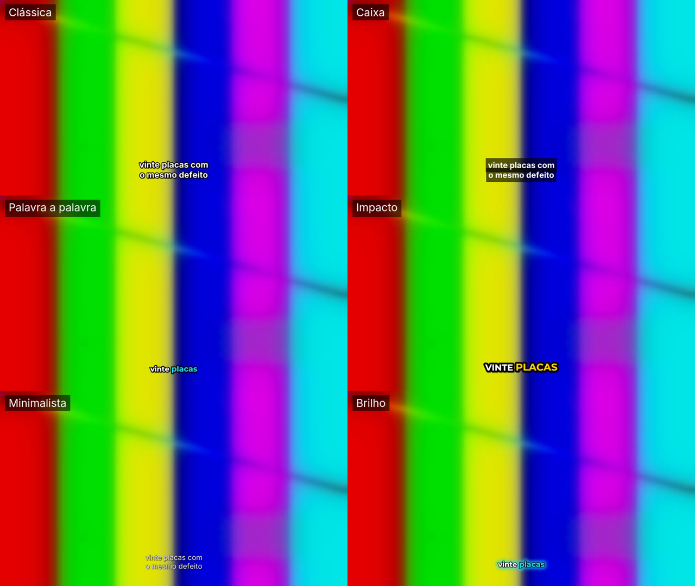

# Estilos de legenda

Os padrões de legenda do motor. Cada estilo define **como a legenda é dividida** (frase inteira ou palavra a palavra, caracteres por linha, caixa alta) e **como ela aparece queimada** (fonte do seu perfil, tamanho, cor, contorno, sombra, faixa, brilho e a cor da palavra falada). O painel desenha a prévia com as mesmas medidas que o render queima no ASS, então o que você escolhe nas boas-vindas é o que sai no vídeo.

| Id | Nome | Divisão | Bom para |
|---|---|---|---|
| `classica` | Clássica | frase | vídeo longo, aula, tutorial |
| `caixa` | Caixa | frase | tela com muito texto, bancada, fundo claro |
| `karaoke` | Palavra a palavra | palavra | YouTube com apresentador, curtos mais calmos |
| `impacto` | Impacto | palavra | reels, shorts, TikTok, ganchos |
| `minimalista` | Minimalista | frase | vídeo-ensaio, narrado, estética limpa |
| `brilho` | Brilho | palavra | tecnologia, games, estilo tech-neon |

## Onde se escolhe

Em camadas, a de baixo vale mais:

1. `legendas` da configuração (`config.py set legendas.estilo impacto`): o padrão dos seus vídeos.
2. `video.legendas` no estado do vídeo: a escolha só deste vídeo (as boas-vindas do painel gravam aqui; à mão, `estado.py . --set video.legendas.estilo caixa`).
3. Arrastada no painel: `video.legendas.deslocamento` (`{x, y}`, frações do quadro a partir da posição do estilo). Vale na legenda queimada e no ASS, que ganha um `\pos` por evento; a legenda animada e o SRT seguem a posição do estilo.
4. As opções da linha de comando (`legendas.py gerar --modo … --max-caracteres …`), só daquela vez.

Configuração antiga, sem `legendas.estilo`, continua como era: o modo, a caixa alta e os caracteres dela valem, e a aparência segue a clássica (ou a palavra a palavra, no modo palavra).

## Os campos

| Campo | O que faz |
|---|---|
| `modo` | `frase` (blocos de uma ou duas linhas) ou `palavra` (a palavra falada acende; só existe queimada) |
| `caixa_alta`, `max_caracteres`, `max_caracteres_vertical`, `linhas` | a divisão em blocos; o limite vertical vale para vídeo 9:16 |
| `fonte`, `peso` | `titulo` ou `texto` (as fontes do seu perfil) ou o nome de uma fonte |
| `tamanho` | multiplica a altura base (5,2% da altura do quadro; 6,2% da largura no vertical) |
| `cor`, `cor_destaque` | hex ou uma cor do tema (`destaque`, `texto`…) |
| `contorno`, `cor_contorno`, `opacidade_contorno`, `sombra` | proporcionais ao tamanho da letra |
| `caixa` | `null` ou `{cor, opacidade}`: a faixa atrás do texto |
| `brilho` | um halo desfocado na cor de destaque atrás do texto |
| `escala_destaque` | quanto a palavra falada cresce (1 = nada) |
| `posicao` | `baixo`, `centro` ou `topo` (o vídeo e a configuração podem trocar) |

Os seus estilos ficam no estoque (`~/.edicao/estoque/legendas/<id>/estilo.json`, pela skill `/edicao:estoque` ou pelo painel), com os mesmos campos, e aparecem junto destes. Um estilo novo do motor é um bloco a mais no `estilos.json`, com outro id: aparece nas boas-vindas e passa na validação da configuração. A imagem acima foi feita com o mesmo ASS que o render queima.
